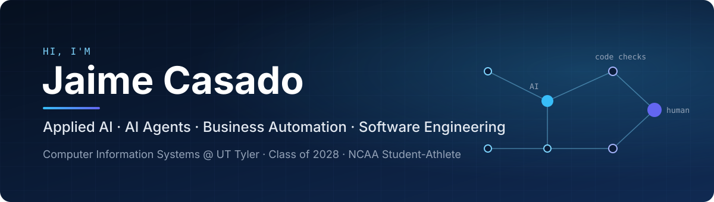

  

### Computer Information Systems Student - The University of Texas at Tyler

Currently focusing on **AI Agents** and **Business Automation**. 
I build AI systems for real businesses, where the AI handles language and tested code makes the decisions.

## Skills & Tech Stack

**AI, Automation & Agents**

**Programming Languages**

**Backend & Databases**

**Tools & DevOps**

## Featured Projects

| Project | What it does | Stack |
|---|---|---|
| [**AI Clinic Automation Engine**](https://github.com/jaimecasadoesteban-jpg/ai-clinic-automation-engine) | WhatsApp assistant for private clinics. Answers patients, offers real appointment times and books them. Safety rules and code checks run around the AI. | TypeScript, PostgreSQL, Claude API |
| [**Starvyin Invoice AI**](https://github.com/jaimecasadoesteban-jpg/starvyin-invoice-ai) | Invoice processing for small businesses. AI reads invoices from email, Telegram or upload, code validates every result, and failures go to human review. | TypeScript, Zod, Claude API |
| [**AI Social Content Pipeline**](https://github.com/jaimecasadoesteban-jpg/ai-social-content-pipeline) | An AI agent plans and builds a week of social media videos, carousels and posts. Code checks quality, and a person approves before publishing. | Python, Node.js, FFmpeg |
